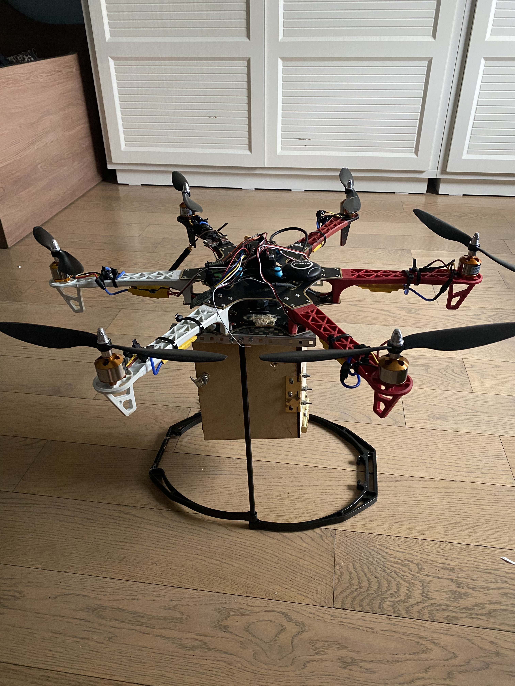
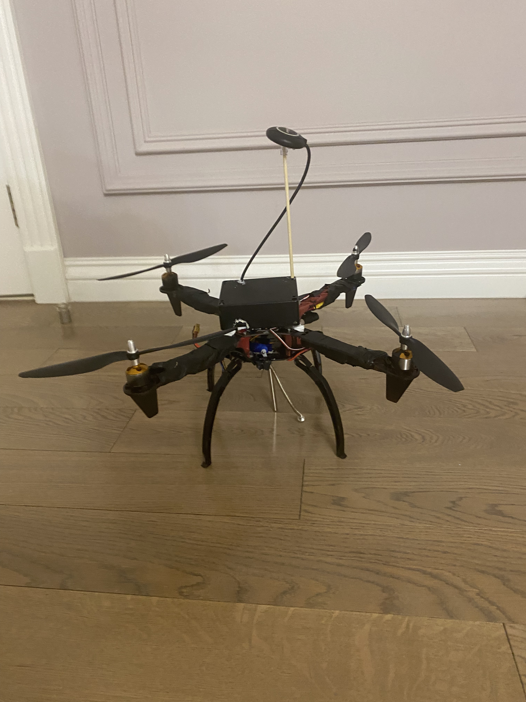

# Saqta — Autonomous Firefighting Drone

Saqta is a firefighting drone I built to fly over a wildfire, sense it, and drop a **CO2 fire-extinguishing ball** onto the flames — the ball bursts on contact with fire and smothers it. Alongside the drop payload it carries a wireless fire-and-climate sensing system that relays live readings back to the ground. This repo holds both halves of the project: the **drone platform** (airframe, motors, flight electronics, and the drop payload) and the **radio telemetry system** (the ESP32 + NRF24L01 climate station that rides on it).

> Built with a friend, originally for **World Robot Olympiad (WRO) 2024**. I led the **hardware** — airframe, motors, flight electronics, wiring, and the telemetry boards; he built the **computer-vision software**. We tested the flights together and split the cost of the parts.

## The drone

It started as a **quadcopter**, then I swapped the frame for a **hexacopter** to get more thrust and lift for the sensor payload — carrying over the same 1400 Kv motors, the same 30 A ESCs, and the same APM 2.8 flight controller.

| Hexacopter (current) | Quadcopter (first build) |
| --- | --- |
|  |  |

**Platform**
- Hexacopter frame — upgraded from the original quad for thrust and payload capacity
- 1400 Kv brushless motors + 30 A ESCs
- APM 2.8 flight controller
- Raspberry Pi for computer vision, wired to the APM over UART
- **Suppression payload:** a CO2 fire-extinguishing ball carried in a drop box under the frame, designed to release over the fire and burst on contact with flame
- Radio telemetry + fire/climate sensor payload (see below)

**Autonomy — honest status.** The goal was autonomous fire-seeking: a Raspberry Pi running computer vision and feeding commands to the APM over UART. In practice it never got to *full* autonomy — the APM 2.8 is an old flight controller and didn't take commands reliably. The clear next step is replacing it with a proper **Pixhawk**, which would open up real autonomous control and tighter CV integration.

---

## Radio telemetry system

A real-time climate-feedback system for Saqta: two independent ESP32 boards send live environmental data over NRF24L01, built up in stages of increasing difficulty.

### Stages

| Folder | What it does | Key concept |
|--------|--------------|-------------|
| `01_basic` | Sends a fixed message from one board to another | SPI to NRF24, addressing, TX/RX roles |
| `02_single_sensor` | Transmits a single sensor reading | Reading a sensor and sending live data |
| `03_multisensor_struct` | Multi-sensor climate station over radio with OLED | Struct-based packets, `sizeof`, multiple sensors |
| `04_bydirectional` | Two-way comms — receiver acknowledges / requests data | Request–response protocol |

### Stage 03 — Climate Telemetry

A wireless climate monitoring system across two independent ESP32 boards. The transmitter reads a set of environmental sensors, packs the readings into a struct, and sends them over the NRF24L01. The receiver unpacks the struct and shows live values on an OLED — no USB tether, each board runs on its own battery. This stage adds Serial Monitor and SSD1306 debug on top of stage 02 for a smoother bring-up.

**Hardware**
- 2× ESP32 (38-pin) — one transmitter, one receiver
- 2× NRF24L01 radio modules
- DHT11 / DHT22 temperature & humidity sensor
- SSD1306 OLED display
- Flame sensor, light sensor (LDR), MQ-2 gas sensor
- Each board runs on its own battery + power switch (fully wireless)

**System overview**
- **TX:** reads flame, light, temperature, humidity, and gas → packs into a struct → sends via NRF24L01
- **RX:** receives the struct → displays live values on the OLED

### TX — Wiring

**NRF24L01 → ESP32**

| NRF24L01 | ESP32 |
|----------|-------|
| VCC | 3.3V |
| GND | GND |
| CE | GPIO 4 |
| CSN | GPIO 5 |
| SCK | GPIO 18 |
| MOSI | GPIO 23 |
| MISO | GPIO 19 |

**OLED Display**

| OLED | ESP32 |
|------|-------|
| VCC | 3.3V |
| GND | GND |
| SDA | GPIO 21 |
| SCL | GPIO 22 |

**Sensors**

| Sensor | ESP32 |
|--------|-------|
| Flame sensor (AO) | GPIO 25 |
| DHT11 data | GPIO 26 |
| Light sensor (AO) | GPIO 35 |
| MQ-2 gas sensor (AO) | GPIO 34 |

### RX — Wiring

**NRF24L01 → ESP32**

| NRF24L01 | ESP32 |
|----------|-------|
| VCC | 3.3V |
| GND | GND |
| CE | GPIO 2 |
| CSN | GPIO 15 |
| SCK | GPIO 18 |
| MOSI | GPIO 23 |
| MISO | GPIO 19 |

**OLED Display**

| OLED | ESP32 |
|------|-------|
| VCC | 3.3V |
| GND | GND |
| SDA | GPIO 4 |
| SCL | GPIO 5 |

## Tech
`C++` · `ESP32` · `NRF24L01` · `SPI` · `SSD1306 OLED` · `APM 2.8` · `Raspberry Pi` · `Computer Vision` · `PlatformIO`
